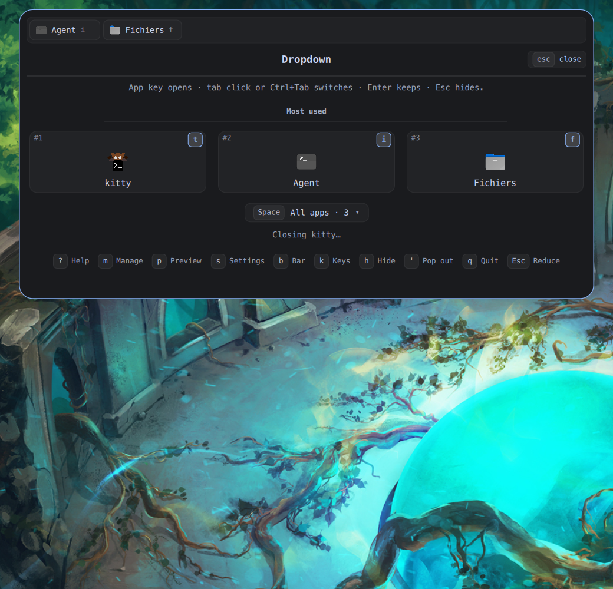
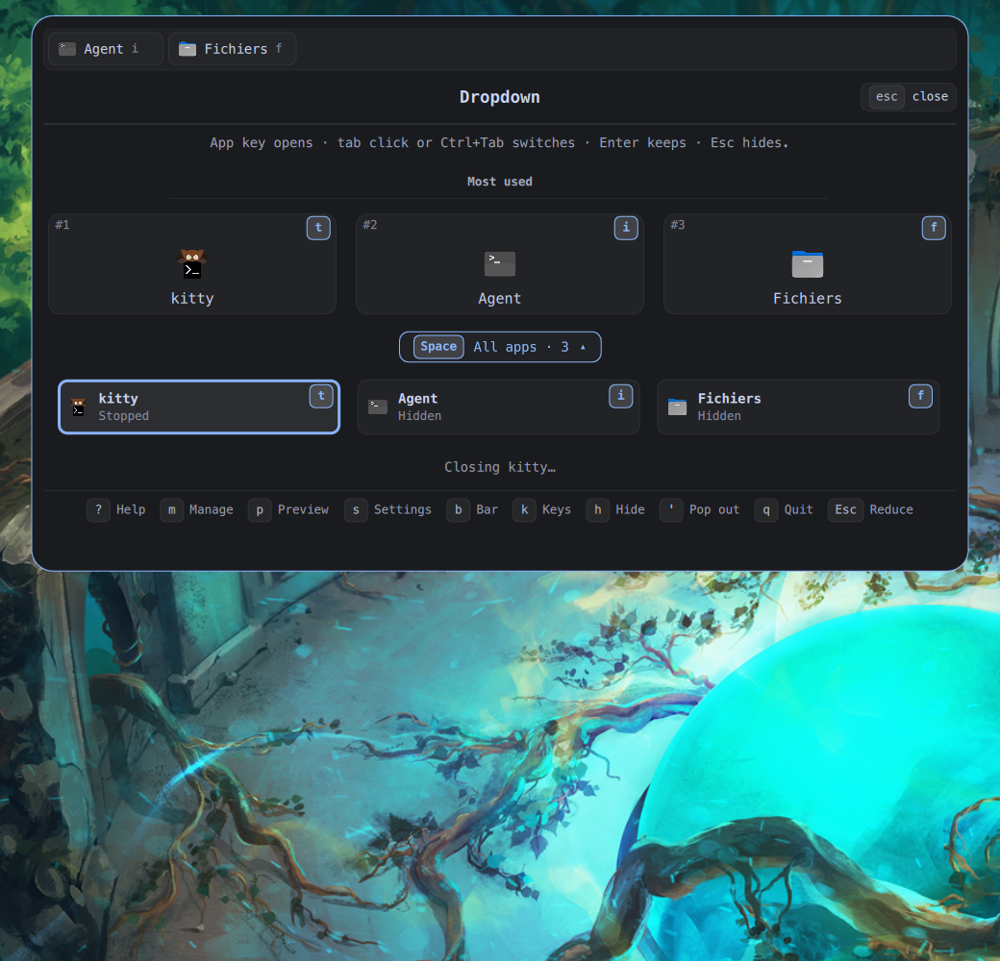
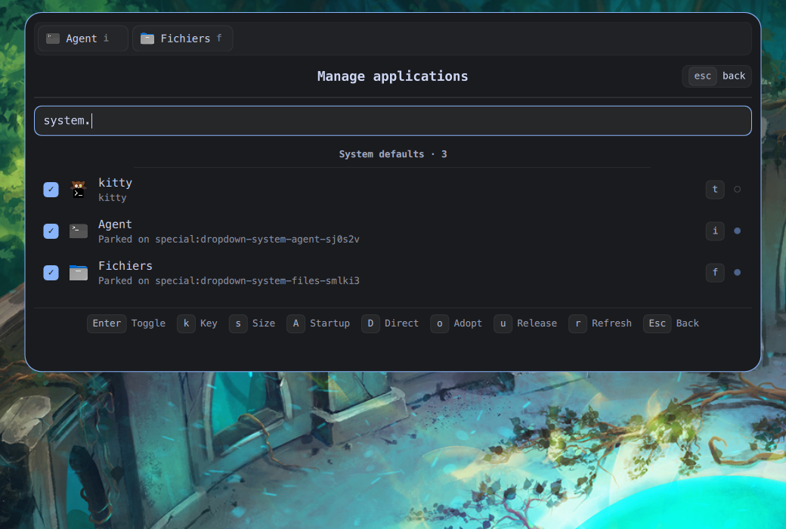
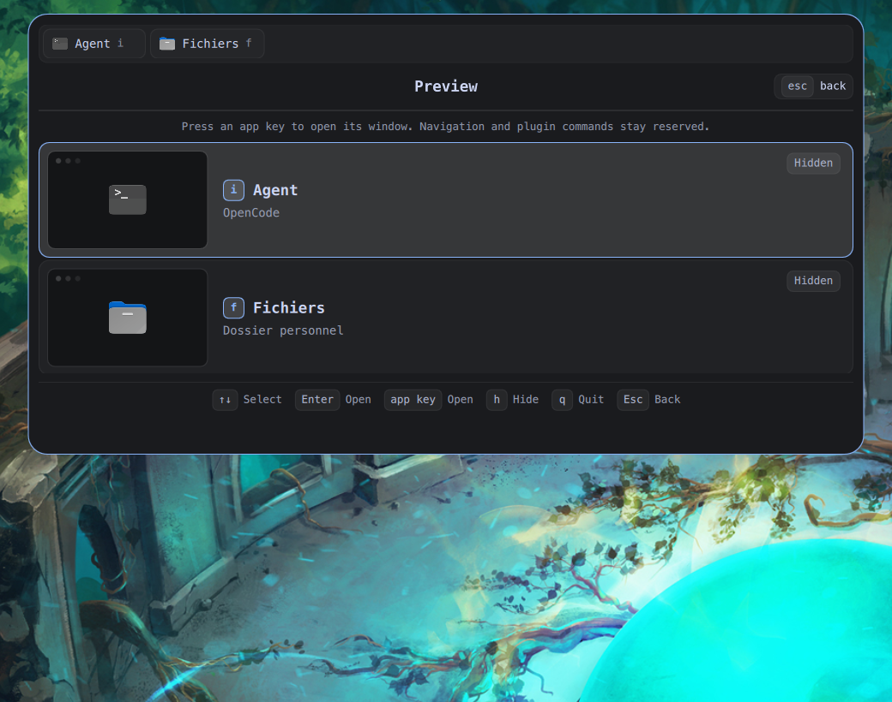
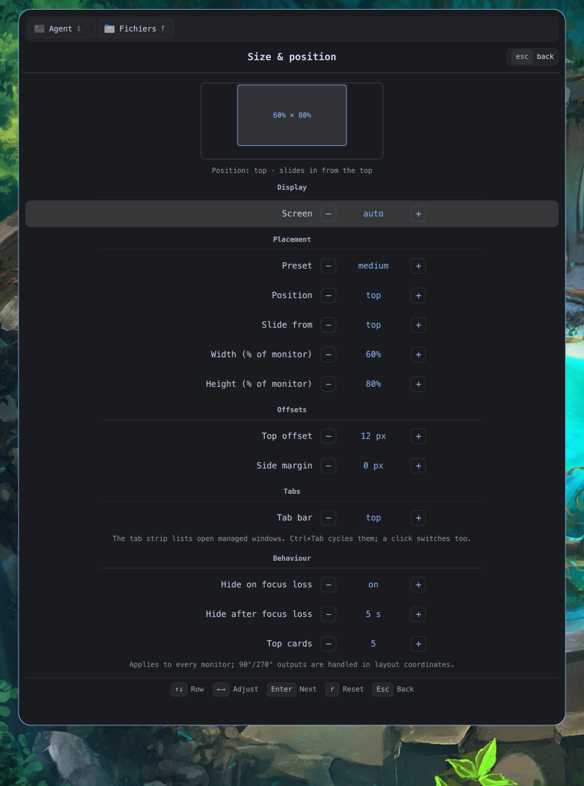
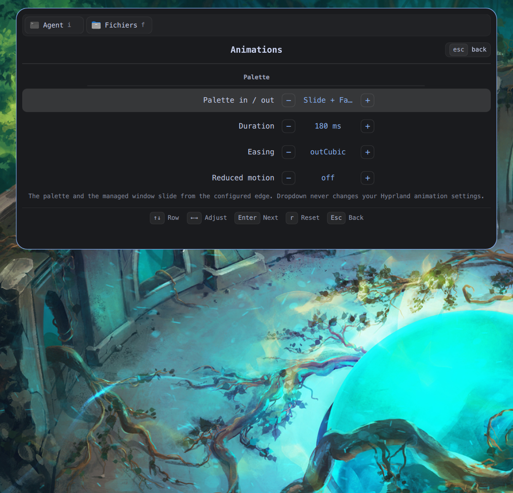
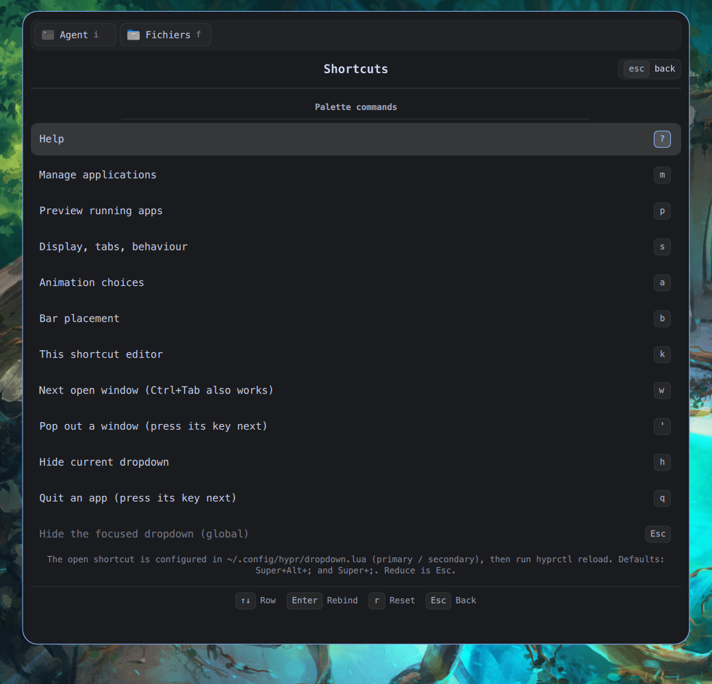
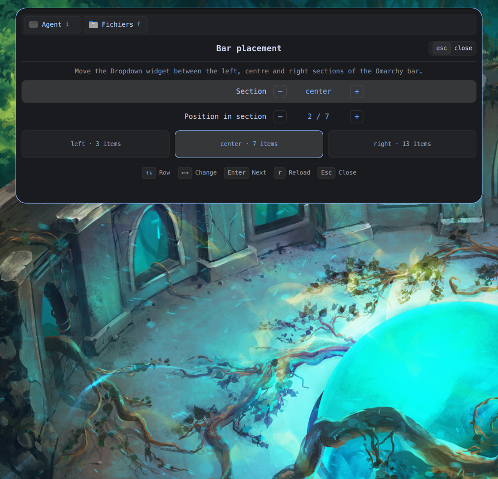
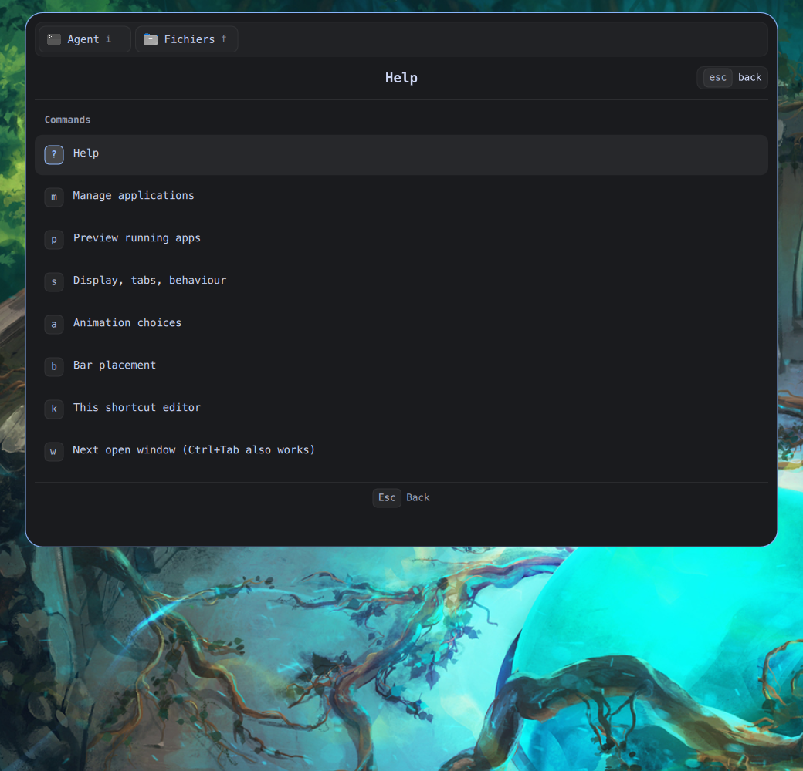
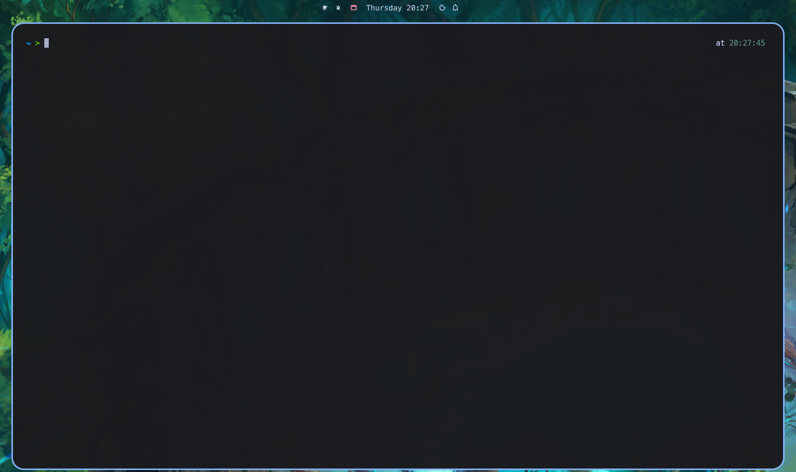

# Omarchy Dropdown

[](https://github.com/ApachaiZ/omarchy-dropdown/releases/latest)
[](https://github.com/ApachaiZ/omarchy-quay)

A keyboard-first dropdown launcher for [Omarchy](https://omarchy.org): one key
opens a compact palette, another key brings a real application window down over
the desktop. Web apps, browser PWAs, ordinary desktop applications, and the
system's default agent, terminal and file manager can be managed.

```
Super + Alt + ;   ▸  t        kitty appears centred on the chosen screen
                  ▸  t        hides it; the session keeps running
                  ▸  t        brings back the same window
                  ▸  q  t     closes only that managed window
```

The window is floating and brought to the front. A card showing the app's
icon and name, with the window's geometry, slides in from the configured
edge, the real window is placed at its final position and fades in beneath
it, then the card fades out. Clicking outside hides the window and returns focus while the
application keeps running in the background.

## Features

- Real native windows — no web views; hidden apps keep their sessions
- Five most-used cards, an all-apps drawer, tabs and a preview overview
- Direct Hyprland shortcuts per app, checked against the live bind table
- Compositor-animated reveal card; the app window itself is never moved
- Atomic config writes with timestamped backups, bind verification and
  orphan-window adoption
- **Quay-aware**: parked windows are tagged `dropdown-hidden`, so
  [Quay](https://github.com/ApachaiZ/omarchy-quay) only lists apps that are
  actually on screen
- Tested pure modules (`Model`, `Keymap`, `Shortcuts`, `ConfigFile`, `State`)
  and GitHub Actions CI



## Quay integration

Dropdown and [Quay](https://github.com/ApachaiZ/omarchy-quay) are designed to
work together. When Dropdown hides an app it parks the real window on a
Hyprland special workspace and tags it **`dropdown-hidden`**. Quay ≥ 1.0.1
reads the tag from `hyprctl clients -j` and leaves that window out of the
shelf, so a hidden Dropdown app is not reported as running. Revealing,
popping out or releasing the app removes the tag and Quay shows it again.

| Dropdown state | Window tag | Quay shelf |
| --- | --- | --- |
| Visible | — | shown as running |
| Hidden (parked) | `dropdown-hidden` | hidden |
| Closed, released or restored | — | shown again |

- Install Quay: `omarchy plugin add https://github.com/ApachaiZ/omarchy-quay --enable --yes`.
- The two plugins are independent: Dropdown works without Quay, and Quay
  filters the tag whenever it is present.
- Any launcher can adopt the same convention: read `hyprctl clients -j` and
  skip entries whose `tags` array contains `dropdown-hidden`.

## Requirements

- Omarchy 4.0.x with the bundled `omarchy-shell` (Quickshell).
- Hyprland 0.56+ in Lua configuration mode.
- A Chromium-based default browser for web apps. Both
  `omarchy-launch-webapp` entries and browser-installed PWAs are recognised.
- No root, no network access, no browser sandbox changes. The installer uses
  `rsync` and `python3` (both ship with Omarchy); the plugin itself only calls
  `hyprctl` and `omarchy-shell`.

Checked against Omarchy 4.0.6, Hyprland 0.56.2 and Quickshell 0.3.2.

## Install

```bash
git clone https://github.com/ApachaiZ/omarchy-dropdown.git
cd omarchy-dropdown
./install.sh
```

Uninstall remembers where the bar widget sat and a later reinstall restores
that placement.

The installer copies the plugin to
`~/.config/omarchy/plugins/apach.dropdown`, creates
`~/.config/omarchy/dropdown.json` if missing, installs
`~/.config/hypr/dropdown.lua`, adds one `require("hypr.dropdown")` line to
`hyprland.lua` (with a backup), enables the plugin, puts its widget on the
right of the bar and reloads Hyprland.

Re-running the installer is safe: it keeps an existing `dropdown.json`, adds
the Hyprland `require`, generated-shortcut loader and Escape submap only when
missing, and `omarchy bar put` leaves an existing widget in place. Generated
direct binds are compared before writing, so an unchanged configuration does
not reload Hyprland or duplicate a bind.

Marketplace install:

```bash
omarchy plugin add https://github.com/ApachaiZ/omarchy-dropdown --enable --yes
```

then copy `hypr/dropdown.lua` and add `require("hypr.dropdown")` yourself.

## Keyboard integration

`~/.config/hypr/dropdown.lua`:

```lua
local primary = "SUPER + ALT + SEMICOLON"
local secondary = "SUPER + SEMICOLON" -- nil disables it
o.bind(primary, "Dropdown palette", "omarchy-shell shell toggle apach.dropdown")
o.bind(secondary, "Dropdown palette (secondary)", "omarchy-shell shell toggle apach.dropdown")
```

`SEMICOLON` is a keysym, not a physical position. Hyprland resolves it through
the active layout, so `;` works on AZERTY and QWERTY. The modifiers do not need
to be held: the binding opens the palette, which grabs the keyboard and waits
for the next key.

Both prefixes accept every command. To change or disable one, edit the
variables and run `hyprctl reload`. Remove the file and the `require` line to
remove the integration; `./uninstall.sh` does that while preserving local
edits.

## Palette

| Key | Action |
| --- | --- |
| an app key (`d`, …) | launch, reveal or hide that app's dropdown |
| `?` | help with the actually configured keys |
| `m` | manage applications |
| `p` | preview running applications |
| `s` | display, position, tabs, window behaviour |
| `a` | palette in/out animation choices |
| `b` | bar widget placement |
| `k` | shortcut editor |
| `w` | next open window (`Ctrl+Tab` also works) |
| `Space` | expand or collapse the all-apps drawer |
| `'` | pop out a window: press `'`, then its key (e.g. `'`, `t` for the terminal) |
| `h` | hide the current dropdown |
| `q` | quit a managed app: press `q`, then the app key (e.g. `q`, `t` for the terminal) |
| `Esc` | hide the focused dropdown (works with or without palette focus) |

These are the default command keys; every one is rebindable in **Keys** (`k`).
An app key can never take a command key silently: Manage explains the conflict
and asks for another key. `t`, `i`, `f` are proposed for terminal, agent and
files, and reserved only while they are enabled.

The base surface is two blocks: **five most-used applications** as equal
cards, then a **horizontal shortcut band** pinned to the bottom. Open windows
live in the tab strip above, so the base palette stays compact and adding
applications can never push the layout outside the frame. The full catalog
remains in Manage.

### All apps drawer

`Space` — or a click on the **All apps** row and its chevron — expands a drawer
under the five cards. It contains a small card for every **enabled**
application, showing its icon, name, palette key, direct Hyprland shortcut (or
live state when none is set). Click a card to open that app and close the
palette. The chevron rotates when the drawer is open; `Space` or the row
collapses it.

Keyboard navigation matches the rendered grid: `↓` enters the drawer from the
cards, arrows move by card, `Enter` opens the selected app, and `Esc` collapses
the drawer before it closes the palette. The number of columns adapts to the
card width (one to three), and the drawer height is capped from the monitor
height, so a large catalog never leaves the card.

`q` opens a small target prompt listing the running apps and their keys; the
next key closes that app (for example `q` then `t` for the terminal). `Esc` cancels
the prompt without closing anything.

The palette is modal and has **no idle timeout**: it stays open until `Esc` or a
click outside the card, whether it was opened by shortcut or by the bar widget.
Outside clicks are caught on every monitor and close it without warping the
pointer. Merely moving the pointer does **not** dismiss it: a focus change on
pointer crossing only starts the configured delay.
Clicking outside returns focus to the window that had it before, without
closing the application. If a dropdown is visible, a real left click outside it
hides it immediately, exactly like Escape; a click inside it (or on one of its
dialogs, or on the bar) is ignored. Pointer moves, focus changes and Alt-Tab
keep the window and let `autoHideDelayMs` decide. The click is observed by a
non-consuming mouse bind in the `apach-dropdown` submap, so the target window
still receives it.

**Escape** is global while a managed window is visible: a temporary Hyprland
submap (`apach-dropdown`) catches it, hides the window and resets the submap.
Opening the palette releases that submap so the palette itself receives keys
normally; closing it re-arms Escape if a dropdown is still visible. The Esc
binding lives in `~/.config/hypr/dropdown.lua`.

## Bar widget

The bar widget is a window outline. It is accent-coloured while a dropdown is
showing and neutral otherwise. Left click opens the palette on that output,
right click opens Manage, and middle click hides the current dropdown.

`b` opens **Bar placement**:

- **Section** — `left`, `center`, `right`;
- **Position in section** — 1-based, bounded by the section's length;
- `↑`/`↓` select a row, `←`/`→`/`Enter` change it, `r` reloads the current
  position, `Esc` closes the palette.

Changes apply live through `omarchy bar move apach.dropdown --section … --index
…`, which rewrites `~/.config/omarchy/shell.json` and rebuilds the bar. The
palette stays open on the same view while the bar moves; a short debounce
coalesces repeated steps. This also applies to other settings: changing Screen,
geometry, animations or tab position never closes the palette. On a portrait
output whose bar sections are cramped, the left section is the most reliable
place for the widget.

## Managing applications

Press `m`. Sections are explicit and searchable:

- **System defaults** — terminal, agent, files (optional, resolved from the
  system defaults at runtime);
- **Web apps** — Omarchy web apps and browser PWAs;
- **Applications** — every visible desktop entry;
- **Missing** — configured entries whose launcher disappeared.

Each section shows its count. Search filters every section and ranks fuzzy
matches (subsequences, word starts).

| Key | Action |
| --- | --- |
| `↑` / `↓` | move between the filter and the list |
| `/` | return to the filter |
| `Enter` | enable/disable the selected entry |
| `k` | assign the next key |
| `s` | per-app size |
| `A` | start this app hidden with the session |
| `D` | bind a direct Hyprland shortcut to this app |
| `o` | explicitly adopt an existing window |
| `u` | release a managed window without closing it |
| `x` | remove a missing entry (press twice to confirm) |
| `r` | refresh catalog and system defaults |

Enabling only authorises management of a **dedicated instance**; it neither
launches anything nor rewrites the desktop entry. A newly enabled entry gets
the first free key. Ordinary windows are never captured silently: adoption is
explicit with `o`.

`A` marks an app to be launched hidden when the graphical session starts. The
plugin records the Hyprland instance signature in its state file, so a shell
restart does not start it again; the next login does. A hidden-start app can be
revealed normally with its key.

`D` binds a **direct Hyprland shortcut** to the selected app. Press the chord
(for example `Super + Shift + T`); the next press opens that app in Dropdown.
`Backspace` clears the binding, `Esc` cancels. Accepted keys are letters,
digits, `F1`–`F24`, arrows, `Tab`, `Space`, `Return`, navigation keys and common
punctuation, always with `Super`/`Alt`/`Ctrl`. Pressing `Enter` applies the
suggested free chord; if an external bind already owns it, Dropdown keeps the
capture open, names the owner and proposes the next free chord. Before applying,
Dropdown checks the **merged Hyprland bind list** (`hyprctl binds -j`), so
Omarchy defaults, user overrides and other plugins are covered. A conflict
keeps the capture open and names the existing binding:

```text
SUPER + N is already bound to Centre de notifications.
Choose another chord or remove that bind.
```

Dropdown never removes another bind automatically. Two Dropdown apps also
cannot share the same chord. The shortcut is stored in `dropdown.json` under the app’s `shortcut`
field and generated into:

```text
~/.config/hypr/dropdown-binds.lua
```

`~/.config/hypr/dropdown.lua` loads that file. The plugin writes it and reloads
Hyprland only when a shortcut, app enablement or app name changes; window
events never do. The file is disposable: it is regenerated from settings. The
same value can be set from a script:

```bash
omarchy-shell apach.dropdown setShortcut system.terminal "SUPER + SHIFT + T"
omarchy-shell apach.dropdown setShortcut system.terminal ""

# Diagnostics: paths, live counts, app state, last dispatch error.
omarchy-shell apach.dropdown doctor
# Same bundle with app ids/names/notes masked, safe to share.
omarchy-shell apach.dropdown doctorRedacted

# Clear the generated direct binds (uninstall does this automatically).
omarchy-shell apach.dropdown cleanup
```

The system defaults are resolved at runtime:

- **Agent** — `omarchy-default-agent`, launched with `omarchy-agent --inline`;
- **Terminal** — `xdg-terminal-exec --print-id`, launched with the dedicated
  app id `apach.dropdown.terminal`;
- **Files** — `xdg-mime query default inode/directory`.

If a default changes, the next launch uses the new value. Existing windows keep
running.

## Preview

`p` opens a visual overview of the managed applications that are running:
window chrome, icon, name, assigned key, live state and window title. Hidden
applications remain in the list as parkable cards. The overview is keyboard
driven and intentionally does not capture screen content, so it never leaks
another window or stale compositor pixels.

Press the **key of an application** to open that window directly: a hidden app
is revealed, a stopped app is launched, and the preview closes. `Enter` or a
click does the same for the selected card. A visible app is never hidden by
this path — closing the preview simply leaves it on screen.

Navigation (`↑`, `↓`, `Enter`, `Esc`) and every palette command key are
reserved. If an app was assigned one of those keys, its card shows a red
`reserved · <command>` label beside the key. Pressing it flashes the card and
shows the reason instead of opening the app; `Enter` and a click still open
that app by id. `h` hides the selected app, `q` closes it, `s` opens its size
settings.

## Tabs

The palette carries a tab strip for every open managed window (`visible` or
`hidden`). It sits at the top or bottom of the palette, selectable in
**Settings** (`s`) → **Tabs** → **Tab bar**. The active tab is the window
currently shown.

- click a tab to switch to that window and close the palette, leaving it on
  screen;
- `Ctrl+Tab` and `Ctrl+Shift+Tab` cycle the windows while the palette stays
  open, so several can be compared; `Enter` keeps the selected window and
  closes the palette without hiding it;
- the configured **Next open window** key (`w` by default, rebindable in
  **Keys**) switches once and closes the palette;
- `Esc` closes the palette and hides the current dropdown as usual.

Only one managed dropdown is visible at a time; switching parks the previous
window and reveals the next one without stealing keyboard focus from the
palette. Tabs keep a readable width and wrap onto a second and third row; the
strip caps at three rows and scrolls internally beyond that, always keeping
the active tab in view.

Cards, application icons and tabs carry a slight pointer-following tilt and
icon parallax to suggest volume. **Reduced motion** (`a`) disables it, along
with the other animations.

A global prefix-free `Ctrl+Tab` is possible but would steal the chord from
every application. `hypr/dropdown.lua` contains the commented `o.bind` lines
for `apach.dropdown next` / `previous`; enable them only if you want that.

## Pop out

`'` then the key of an open window detaches it from Dropdown and leaves it
open as an ordinary tiled window. For example `'` then `t` pops out the terminal.
`Esc` cancels the prompt without touching any window.

The window is moved back to its previous workspace if it was parked,
unfloated, and focused. The app stays enabled in **Manage**: pressing its key
later opens a fresh dropdown, while the popped-out window remains normal.
`release` (`u` in Manage) remains the non-focusing variant.

Both `'` and `w` are ordinary palette commands and can be rebound in **Keys**
like `q`, `h` or `m`. The tab bar position is a setting, not a key.

## Screens

**Screen** is a first-class setting in `s`:

- `auto (follow focus)` — opens on the focused monitor, or on the monitor whose
  bar widget was clicked;
- `HDMI-A-1`, `HDMI-A-2`, … — always opens on that monitor, wherever keyboard
  focus is.

A fixed screen is a hard target: the dropdown is moved to that monitor's
**current workspace**, never to a stale workspace or workspace 1. If the app is
already visible on another workspace or output, the next summon moves it to the
requested screen instead of just hiding it.

`openOn`/`manageOn` bypass the preference for scripts:

```bash
omarchy-shell apach.dropdown openOn HDMI-A-1
omarchy-shell apach.dropdown manageOn HDMI-A-1
```

The palette is one surface on one output, not an instance per screen. A parked
window on another output is moved to the requested workspace and re-geometried.
If the chosen output disappears, the plugin falls back to the focused output;
an open palette on a removed output closes cleanly.

Geometry uses Hyprland layout values, including reserved bar space and 90°/270°
transforms. Monitor and geometry changes are revalidated without per-frame
work.

## Lifecycle

| State | Meaning |
| --- | --- |
| stopped | no managed window |
| launching | bounded 20 s wait for a new window |
| visible | floating on the target workspace, geometry applied |
| hidden | parked on `special:dropdown-<app>-<hash>` |
| closing | graceful close requested |
| error | launch/adoption failure with a reason |

- One managed dropdown is visible at a time, globally across monitors.
- Recall a visible app to hide it; recall a hidden app to bring back the same
  window and session. Hidden applications keep running; Dropdown never suspends
  them.
- A visible dropdown is raised above other floating windows. A left click
  outside hides it immediately and keeps focus on the clicked window; a click
  inside it is passed through untouched. Moving the pointer or Alt-Tab starts
  the configured delay instead of hiding at once.
- Closing uses `hl.dsp.window.close` on one address; never `pkill`, never a
  class-wide close, never a shared browser process.
- Parked windows are tagged `dropdown-hidden` in Hyprland; the tag is removed
  on reveal, release or restore. Quay ≥ 1.0.1 filters it, and any other
  launcher can do the same.
- Quitting a hidden window (`q`, then its key) reveals it first so a
  confirmation is visible.
- Dialogs sharing the dedicated instance's class/pid are parked and restored
  with it. File managers are excluded because their class is shared with
  ordinary windows.
- Disabling an app or the plugin releases parked windows to a real workspace.
  A shell restart or code reload preserves parked windows and re-adopts them.
- Disabling or removing the plugin also clears the generated direct binds, so
  no shortcut points at a dead service. `apach.dropdown cleanup` does the same
  on demand.
- A shell crash is recovered from the state file and the `special:dropdown-*`
  workspaces.

## Interoperability with other launchers

Hyprland has no `skip_taskbar` flag, so every mapped window appears in docks
and app switchers. Dropdown marks its parked windows so other tools can leave
them out deliberately.

- A parked window carries the Hyprland tag **`dropdown-hidden`**. The tag is
  removed when the window is revealed, released, popped out or restored.
- [Quay](https://github.com/ApachaiZ/omarchy-quay) **≥ 1.0.1** skips clients
  with that tag, so Dropdown apps that are parked do not appear as running in
  the shelf. See [Quay integration](#quay-integration) for the full lifecycle.
- A switcher that does not filter the tag yet can still select a parked
  window: it is adopted as the current dropdown and Escape hides it again.
- Any launcher can adopt the same convention: read `hyprctl clients -j` and
  ignore entries whose `tags` array contains `dropdown-hidden`.

## Position, size and motion

`s` opens the settings:

- **Display → Screen**: auto or a specific output.
- **Placement → Position**: `top` by default (top edge, centred horizontally),
  or `center`, `bottom`, `left`, `right`.
- **Slide from**: `top` by default; independent of the final position. The
  window leaves the chosen screen edge and settles in its target position.
- **Tabs → Tab bar**: `top` or `bottom` of the palette.
- Presets: compact 45 × 65 %, medium 60 × 80 %, large 75 × 90 %, custom.
- Width/height as a percentage of the monitor, top offset, side margin.
- Per-app width/height override (`s` in Manage or a list).

The preview shows the target position and where the window will land. Values
are clamped and written atomically to `~/.config/omarchy/dropdown.json`.

Animations:

- **Palette in / out** (`a`): `none`, `slide`, `fade`, `slide+fade`, `scale`,
  `scale+fade`, `zoom`, `zoom+fade`, `bounce`, `bounce+fade`, `slideH`,
  `slideH+fade`; the same mode plays forward on open and backward on close.
  Duration, easing and reduced motion remain configurable.
- **Managed window**: a compositor-animated shell card slides in from the
  configured edge while the real window fades in at its final position; the
  app window itself is never moved. Reduced motion shows it immediately.
- The **hide delay** lives with the window behaviour: `s` → **Behaviour** →
  **Hide after focus loss** (5 s by default, 0–30 s), used whenever focus
  leaves the dropdown without a click (pointer move, Alt-Tab, workspace
  switch). **Hide on focus loss** toggles the whole behaviour.
- Reduced motion disables all of them;
- no global Hyprland animation setting is changed.

## Configuration

`~/.config/omarchy/dropdown.json` (schema version 1):

```json
{
  "schemaVersion": 1,
  "settings": {
    "screen": "auto",
    "autoHideDelayMs": 5000,
    "geometry": {
      "preset": "medium",
      "placement": "top",
      "edge": "top",
      "widthPercent": 60,
      "heightPercent": 80,
      "topOffset": 12,
      "sideMargin": 0
    },
    "animations": {
      "mode": "slide+fade",
      "durationMs": 180,
      "easing": "outCubic",
      "reducedMotion": false
    },
    "autoHideOnFocusLoss": true,
    "topApps": 5,
    "tabs": { "position": "top" },
    "commands": {
      "help": "?", "manage": "m", "preview": "p",
      "settings": "s", "motion": "a", "shortcuts": "k",
      "hide": "h", "quit": "q", "bar": "b",
      "popout": "'", "nextWindow": "w"
    }
  },
  "apps": {
    "system.terminal": { "enabled": true, "key": "t" },
    "system.agent": { "enabled": true, "key": "i" },
    "system.files": { "enabled": true, "key": "f" }
  }
}
```

- `screen`: `auto` or a monitor name. `placement`: `top` (default) or an edge/centre.
  `edge`: slide origin (default `top`). Unknown values fall back to
  `auto`, `top`, `top`.
- Invalid values are dropped; percentages clamp to 20–100, duration 0–800 ms.

- `topApps` (3–7) is the number of cards shown above the all-apps drawer.
- Web apps are keyed by desktop-entry id, with `url` kept for renames. Only
  plain `http(s)` URLs without quotes, whitespace or control characters are
  accepted, and an unsafe value is ignored with a warning.
- A missing entry is reported without invalidating the rest.
- The file is watched and hot-reloaded; writes are atomic.
- Dropdown ignores the file-change event caused by its own write. A real
  external edit is adopted and backed up as `dropdown.json.bak-YYYYMMDD-HHMMSS`
  (five kept). Invalid JSON is backed up but never adopted or overwritten: the
  running settings stay active until the file is valid again.
- If local edits are pending when an external write lands, the local edits win
  and the external file is backed up first.

Ephemeral window identifiers live in
`~/.local/state/omarchy/dropdown-state.json`. Addresses are validated against
the live client list; a stale address is never applied.

## Safety and performance

- Launches go through Hyprland's exec rules: the window maps directly on its
  parked special workspace, floating and transparent, so it never flashes at a
  default position. The parsed desktop-entry argv is shell-quoted before being
  handed to Hyprland; the entry `Exec` is never `eval`-ed.
- Window operations use validated hex addresses and quoted workspace names.
- A new instance is identified from a pre-launch window snapshot, so an
  ordinary window is not moved or resized by accident.
- No cookies, tokens, URLs or application content are logged.
- Config backups stay in `~/.config/omarchy/` and contain only the same settings
  as `dropdown.json`; they are never uploaded.
- `doctor` and `status` are local read-only IPC calls; redact app names before
  posting their output publicly.
- Event-driven: `Hyprland` window/workspace/monitor events; debounced
  `hyprctl clients -j`; no timer while idle; launch watcher only for the
  bounded launch; opacity fade only on reveal.

See `docs/performance.md` for the reproducible idle measurement,
`docs/validation.md` for what was exercised and what remains environment
dependent, and `docs/troubleshooting.md` for symptom-based fixes.

## Screenshots

All captures use the three standard Omarchy system defaults (kitty, Agent,
Fichiers) on an empty workspace. See `docs/screenshots/README.md` for the
palette, all-apps drawer, Manage, Preview, Settings, Animations, Shortcuts, Bar
placement, Help, and kitty running in the dropdown.

| | |
| --- | --- |
|  |  |
|  |  |
|  |  |
|  |  |
|  |  |

Full-screen kitty capture: `docs/screenshots/kitty.png`. Overview sheet:
`docs/screenshots/cards-contact.png`.

## Development

The pure decision logic lives outside QML so it can be tested without a
compositor:

- `Model.js` — config validation, geometry, shortcut normalization;
- `js/Keymap.js` — palette intent and drawer grid movement;
- `js/Shortcuts.js` — shortcut ownership, Hyprland conflicts, Lua rendering;
- `js/ConfigFile.js` — atomic-write policy, backups, invalid-JSON handling;
- `js/State.js` — managed-window state labels.

`docs/architecture.md` describes the service lifecycle, config write policy and
shortcut generation. GitHub Actions runs the unit tests, shell syntax check,
manifest check and plugin validation on every push.

```bash
node --test tests/*.test.mjs   # unit tests
./tests/run.sh                 # unit tests + omarchy plugin validate
```

```bash
tests/run.sh
```

runs the model/manifest tests and `omarchy plugin validate` when available.
The current suite has 63 tests.

## Uninstall

```bash
./uninstall.sh
```

or manually: disable the plugin, remove
`~/.config/omarchy/plugins/apach.dropdown`, delete the `require` line and
`~/.config/hypr/dropdown.lua`, then `hyprctl reload`. Settings and application
data are preserved.

## License

MIT.
